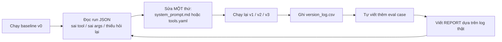

# Hướng dẫn chi tiết — Day 03 Lab v2: Research Agent Tool Eval

> Tài liệu hướng dẫn đọc lab `starter_v0/`. Mục tiêu: giúp một thành viên trong nhóm
> từ số 0 đi tới nộp bài (setup → baseline → tối ưu prompt/tools → tool mới → test → eval nhóm → UI → report → bonus).
>
> Thư mục làm việc: `starter_v0/` (đường dẫn gốc của repo lab).

---

## 1. Bài lab này thực chất dạy gì?

Không phải "làm chatbot trả lời hay". Điểm cần học là vòng lặp **evidence-driven** (ra quyết định dựa trên bằng chứng log thật):



Điểm mấu chốt: **starter cố tình để xấu** để bạn sửa.

- `artifacts/system_prompt.md` — prompt xấu: xúi *"đừng hỏi lại, cứ đoán bừa; gặp tweet không rõ ai thì đoán Sam Altman; muốn gửi thì gửi luôn; luôn làm xong trong 1 bước"*.
- `artifacts/tools.yaml` — `description` mơ hồ, thiếu rule routing, thiếu convention args (handle, `topic=news`, `timeframe`, `search_type=Top|Latest`), thiếu ranh giới xác nhận của `send`.

Nhiệm vụ của nhóm: làm cho agent **route đúng tool + truyền đúng args + đúng boundary** (hỏi lại khi thiếu thông tin, xác nhận trước khi gửi), rồi **đo bằng eval**.

---

## 2. Cơ chế eval — hiểu để làm đúng

Luồng chấm điểm:

- `run_eval.py` nạp case từ JSON, gọi `ResearchAgent.run(...)` cho từng case.
- Với case bình thường, `tool_choice="required"` (ép model phải gọi tool). Với case `no_tool=true`, không ép.
- So khớp trong `evaluate_phase_b`: **subset match** — tên tool phải khớp, mỗi key trong `expect.args` phải khớp giá trị (chuỗi được `strip().lower()`), và **không được thừa tool call**.

Các chỉ số trong `summary`:

| Metric | Ý nghĩa |
|---|---|
| `case_accuracy` | tỉ lệ case pass trên tổng case đo được (bỏ `provider_error`) |
| `tool_routing_accuracy` | tỉ lệ chọn đúng tool (phase B) |
| `argument_accuracy` | tỉ lệ truyền đúng args (phase B) |
| `multiturn_accuracy` | tỉ lệ pass các case multi-turn |
| `failure_counts` | đếm theo `failure_type` |
| `observed_mismatch_counts` | đếm theo kiểu lệch thực tế (`missing_tool_call`, `wrong_arg_value`, `extra_tool_call`...) |

Các loại `failure_type` hợp lệ (khai báo trong `run_eval.py` và `eval_group.json`):

`wrong_tool`, `wrong_arg_value`, `wrong_boundary`, `unnecessary_tool`, `out_of_scope`, `missing_info`.

**Quy tắc vàng về tên tool:** eval chấm theo **đúng tên khai báo**. Nếu rename một tool (ví dụ `send` → `send_telegram`), phải đồng bộ ở **cả 3 nơi**:

1. `artifacts/tools.yaml` — field `name`
2. `tools/__init__.py` — key trong `TOOL_FUNCTIONS`
3. `data/eval_base.json` **và** `data/eval_research_extension.json` — `expect.tool_calls[].name`

Không sửa *nội dung case* trong `eval_base.json`; chỉ đổi tên tool nếu nhóm rename. `pytest tests/test_tool_contract.py` sẽ kiểm tra đồng bộ giúp bạn.

**Cấu trúc một case eval:**

```json
{
  "id": "G01_...",
  "phase": "B",
  "query": "câu hỏi single-turn",
  "failure_type": "wrong_tool",
  "expect": {"tool_calls": [{"name": "lookup", "args": {"topic": "news"}}]},
  "metadata": {"what_it_tests": "mô tả case kiểm tra gì"}
}
```

Với multi-turn thì dùng `turns` thay cho `query`:

```json
{
  "id": "G06_...",
  "phase": "B",
  "turns": [
    {"role": "user", "content": "lượt 1"},
    {"role": "user", "content": "lượt 2"},
    {"role": "user", "content": "lượt cuối — chỉ chấm lượt này"}
  ],
  "failure_type": "wrong_arg_value",
  "expect": {"tool_calls": [{"name": "timeline", "args": {"screenname": "elonmusk", "limit": 3}}]}
}
```

---

## 3. Danh sách tool có sẵn

Core tools:

| Tên | Làm gì | Track |
|---|---|---|
| `clarify` | gửi một câu hỏi cho user và chờ lượt sau | core |
| `timeline` | lấy bài đăng gần đây của một tài khoản (`screenname`) | core |
| `social_search` | tìm bài đăng theo từ khóa (`search_type`: Latest/Top) | core |
| `lookup` | tìm trên web (`topic` general/news, `timeframe`) | core |
| `fetch` | đọc nội dung một URL | core |
| `format` | trình bày item đã có thành markdown digest | core |

Bonus tools:

| Tên | Làm gì | Track |
|---|---|---|
| `send` | gửi text lên Telegram channel (chỉ gửi khi `confirmed=true`) | bonus |
| `policy` | tìm trong company policy markdown nội bộ | bonus |
| `papers` | tìm paper trên arXiv | bonus |
| `paper_text` | tải PDF arXiv và trích text cục bộ | bonus |

Mỗi tool nằm trong thư mục riêng `tools/<tool_name>/` gồm `TOOL.md` (frontmatter + notes) và `tool.py` (implementation tự chứa).

---

## 4. Nhiệm vụ bắt buộc (tóm tắt)

1. Setup chạy được bằng provider thật.
2. `tools.yaml` có **≥ 5 tool**.
3. Chạy **base eval** (`v0`).
4. Tối ưu **≥ 3 vòng** sau baseline: `v1`, `v2`, `v3` — mỗi vòng **một** giả thuyết.
5. Ghi `artifacts/version_log.csv`.
6. Viết **≥ 1 tool mới**: `tools/<tên>/tool.py` + `TOOL.md`, đăng ký ở `tools/__init__.py` (`TOOL_FUNCTIONS`) và `artifacts/tools.yaml`.
7. Unit test cho tool mới (**≥ 3 test/tool**), giữ `pytest` xanh.
8. Thêm **10 eval case** vào `data/eval_group.json` (5 single-turn + 5 multi-turn).
9. Nộp run JSON, transcript JSON, report.
10. **Bắt buộc có UI** chạy được (Streamlit hoặc Vercel).
11. `REPORT.md`: **Phần A trước 16:30** (giới thiệu agent), Phần B nộp sau.

**Bonus:** `send` có confirmation (kèm transcript chứng minh); extra tools (`policy`, `papers`, `paper_text`); **Small Local Model Challenge** (Ollama ≤ 8B).
**Điểm thưởng:** làm **cả** UI **và** tự viết **> 3 tool mới**.

---

## 5. Setup môi trường

Chạy trong `starter_v0/`:

```bash
python -m venv .venv
source .venv/bin/activate            # macOS/Linux
pip install -r requirements.txt
cp .env.example .env
```

Trên Windows (PowerShell):

```powershell
python -m venv .venv
.venv\Scripts\activate
pip install -r requirements.txt
copy .env.example .env
```

Điền `.env` (tối thiểu khuyến nghị):

```dotenv
OPENROUTER_API_KEY=...
TAVILY_API_KEY=...
FIRECRAWL_API_KEY=...
RAPIDAPI_KEY=...
RAPIDAPI_TWITTER_HOST=twitter-api45.p.rapidapi.com
```

Key lấy ở đâu + smoke test từng tool: xem [TOOL-SETUP.md](TOOL-SETUP.md).

Preflight:

```bash
python scripts/preflight_provider.py --provider openrouter
```

Nếu preflight fail → sửa provider key / dependency / network trước khi chạy eval.

---

## 6. Bước 1 — Chạy baseline `v0`

```bash
python run_eval.py --provider openrouter --version v0 --suite base --eval-cases data/eval_base.json
```

Output lưu vào `runs/*.json`. Đọc:

- `summary.case_accuracy`
- `summary.tool_routing_accuracy`
- `summary.argument_accuracy`
- `summary.multiturn_accuracy`
- `results[*].result.failures`
- `results[*].result.observed_mismatch`

Run JSON cũng lưu `artifact_version`, `prompt_hash`, `tools_hash`, tool calls + tool results thật → **đây là bằng chứng cho report**.

Tuỳ chọn: parse ra CSV để dễ phân tích:

```bash
python scripts/parse_runs.py runs/ --output analysis/base_runs.csv
```

---

## 7. Bước 2 — Sửa **một** thứ (một giả thuyết)

Chỉ được sửa:

- `artifacts/system_prompt.md`
- `artifacts/tools.yaml`

**Không sửa case trong `data/eval_base.json`.**

Phương pháp (không học thuộc đáp án):

1. Mở run JSON. Với mỗi case FAIL, đọc `observed_mismatch` + `failures` + `actual_tool_calls`.
2. Đặt **một** giả thuyết: *vì sao* agent chọn sai (thiếu rule routing? thiếu convention args? prompt đang xúi đoán/gửi/làm-một-bước?).
3. Sửa **một** thứ (một dòng prompt hoặc một `description`) để kiểm chứng giả thuyết đó.
4. Chạy lại, so metric trước/sau. Không cải thiện thì đổi giả thuyết.

Việc cần làm cụ thể:

**`system_prompt.md`**
- Bỏ chỉ dẫn xấu: đoán thay vì hỏi, gửi không xác nhận, ép làm một bước.
- Thêm rule routing: khi nào dùng `timeline` / `social_search` / `lookup` / `fetch` / `clarify`.

**`tools.yaml`**
- Viết lại `description` mỗi tool: làm gì, **khi nào dùng / khi nào KHÔNG dùng**.
- Mô tả rõ convention args: handle **không có `@`**, `topic=news` cho tin tức, `timeframe`, `search_type=Top|Latest`.
- `send`: mô tả rõ chỉ gửi khi user đã xác nhận (`confirmed=true`).

> **Đổi một giả thuyết mỗi lần** để version log có ý nghĩa.

---

## 8. Bước 3 — Chạy ≥ 3 version tối ưu

```bash
python run_eval.py --provider openrouter --version v1 --suite base --eval-cases data/eval_base.json
python run_eval.py --provider openrouter --version v2 --suite base --eval-cases data/eval_base.json
python run_eval.py --provider openrouter --version v3 --suite base --eval-cases data/eval_base.json
```

Sau mỗi run, điền `artifacts/version_log.csv`:

```text
version,author,changed_artifact,artifact_version,prompt_hash,tools_hash,reason,hypothesis,metric_before,metric_after,run_file
```

Lấy `prompt_hash`, `tools_hash`, `artifact_version` và đường dẫn run file từ output eval.

---

## 9. Bước 4 — Thêm eval case của nhóm

`data/eval_group.json` hiện là `"cases": []` — bạn thêm case. Yêu cầu nộp: **10 case** (5 single-turn + 5 multi-turn); README gốc ghi tối thiểu 5.

Mỗi case cần:

- `id`
- `phase`: luôn `"B"`
- `query` **hoặc** `turns`
- `failure_type`: một trong danh sách allowed
- `expect`: `tool_calls` hoặc `no_tool`
- `metadata.what_it_tests`

Chạy suite nhóm:

```bash
python run_eval.py --provider openrouter --version v3 --suite group --eval-cases data/eval_group.json
```

Tuỳ chọn suite mở rộng:

```bash
python run_eval.py --provider openrouter --version v3 --suite extension --eval-cases data/eval_research_extension.json
```

---

## 10. Bước 4b — Viết unit test cho tool

Eval ở Bước 4 đo **model** (chọn tool/args đúng không). Unit test đo **code của tool** (nhận args đó chạy đúng không). Hai loại lỗi khác nhau: model gọi đúng `lookup(topic="news")` nhưng tool quên gửi `topic` lên API → eval vẫn PASS, user vẫn nhận kết quả sai.

```bash
pytest
pytest -v tests/test_tools_todo.py
```

Có sẵn:

- `tests/test_tool_contract.py`: kiểm tra `tools.yaml` ↔ code ↔ eval đồng bộ (mỗi tool khai báo phải có implementation, mọi param khai báo phải có trong signature, có `TOOL.md` đúng tên, eval chỉ dùng tool đã khai báo). **Test này phải luôn xanh**, chạy lại mỗi khi rename/thêm tool.
- `tests/test_tools_examples.py`: 5 mẫu để copy — tool local thuần; guardrail (`send` không gửi khi chưa xác nhận); mock HTTP cho tool gọi API; nhánh lỗi (thiếu key, HTTP 429); test vòng lặp agent bằng fake provider.
- `tests/conftest.py`: **mọi HTTP thật bị chặn** — phải mock bằng fixture `fake_http`; env key bị xoá trước mỗi test.
- `tests/test_tools_todo.py`: các stub `pytest.skip(TODO)` cần điền (clarify, format, send, lookup, fetch, timeline, social_search, policy + tool mới của bạn).

Nhiệm vụ:

1. **Bắt buộc:** ≥ 3 test cho mỗi tool mới (happy path; input xấu từ model như chuỗi rỗng, sai kiểu, ngoài enum; nhánh lỗi trả error dict chứ không raise).
2. **Challenge:** điền hết `pytest.skip(TODO)` trong `test_tools_todo.py`. Đạt khi `pytest` báo **0 failed, 0 skipped**.
3. **Challenge+:** nếu test phát hiện bug trong tool có sẵn → ghi lại bug, sửa, giữ lại test (regression test). Ghi vào REPORT B5. Gợi ý input biên model hay gửi: `limit=0`, `top_k=0`, số dạng chuỗi (`max_results="5"`), `items` thiếu `url`.

Nguyên tắc: một test kiểm tra một hành vi; tên test mô tả hành vi (`test_send_without_confirmation_does_not_call_network`); assert cả **request gửi đi** lẫn **kết quả trả về**.

---

## 11. Bước 5 — Chat live (multi-round)

```bash
python chat.py --provider openrouter --version v3
```

`chat.py` log mỗi lượt vào `transcripts/*.transcript.json`. Thử ≥ 3 lượt:

- Một research request bình thường.
- Một request thiếu thông tin (không nói account/URL), rồi lượt sau bổ sung.
- Một request "đăng/gửi bản tin lên Telegram" — quan sát agent có gửi ngay hay hỏi lại trước, rồi quyết hành vi đúng và sửa prompt cho khớp.

---

## 12. UI + Deploy nhanh (Cloudflare Tunnel)

README **bắt buộc có UI** (Streamlit hoặc Vercel). Cách expose nhanh ra link public để team khác thử:

1. Chạy UI local (Streamlit mặc định `8501`):

   ```bash
   streamlit run app.py            # → http://localhost:8501
   ```

2. Cài `cloudflared`:

   ```bash
   brew install cloudflared                          # macOS
   winget install --id Cloudflare.cloudflared        # Windows (hoặc: scoop install cloudflared)
   # Linux: https://developers.cloudflare.com/cloudflare-one/connections/connect-networks/downloads/
   ```

3. Mở tunnel trỏ vào cổng UI — lệnh trả về ngay URL `https://<random>.trycloudflare.com`:

   ```bash
   cloudflared tunnel --url http://localhost:8501
   ```

4. Copy URL đó, dán vào `REPORT.md` Phần A (mục "Link dùng thử").

> Link `trycloudflare.com` là tạm thời, sống theo phiên `cloudflared` (tắt lệnh là mất). Giữ lệnh chạy suốt buổi showdown. Nếu deploy hẳn lên Vercel/Streamlit Cloud thì dùng link đó thay tunnel.

---

## 13. Bước 6 — Report + Debate Poster

Hoàn thành `artifacts/REPORT.md` (2 phần, deadline khác nhau):

- **Phần A — Giới thiệu agent** (1 trang, **xong trước 16:30**): (1) agent làm được gì, (2) có tool gì và mỗi tool làm được gì, (3) vài câu hỏi mẫu, (4) link dùng thử. Có thể làm thêm `artifacts/poster.html` / `poster.svg` để show (tuỳ chọn, không thay bản markdown).
- **Phần B — Chi tiết / Bằng chứng** (nộp sau showdown): bảng v0–v3, failure analysis, eval cases, live chat, reflection — dựa trên log thật (run JSON, version_log).

---

## 14. Bước 7 (Bonus) — Small Local Model Challenge

Câu hỏi: **prompt + tool declaration tối ưu cho model cloud có còn đúng khi chạy model nhỏ (3B–8B) trên máy mình không?**

### Setup

1. Cài [Ollama](https://ollama.com/download), chạy `ollama serve` (app desktop tự chạy sẵn).
2. Kéo **≥ 2** model hỗ trợ tool calling, khác kích thước:

   ```bash
   ollama pull qwen2.5:7b      # mặc định của provider, ~4.7 GB
   ollama pull llama3.2:3b     # nhỏ hơn, ~2 GB
   # Gợi ý khác: qwen2.5:3b, llama3.1:8b, mistral:7b
   ```

   Máy yếu (RAM < 16 GB): dùng model 3B. Không cần API key; provider `ollama` gọi `http://localhost:11434/v1`.

3. Preflight:

   ```bash
   python scripts/preflight_provider.py --provider ollama --model qwen2.5:7b
   ```

### Nhiệm vụ

1. **Baseline local:** chạy base eval với prompt/tools **v3**, không sửa gì, trên từng model local:

   ```bash
   python run_eval.py --provider ollama --model qwen2.5:7b  --version v3-qwen7b  --suite base --eval-cases data/eval_base.json
   python run_eval.py --provider ollama --model llama3.2:3b --version v3-llama3b --suite base --eval-cases data/eval_base.json
   ```

2. **Phân loại lỗi:** đọc run JSON, đếm lỗi đặc thù model nhỏ: `wrong_tool`/bịa tool không có; JSON args lỗi (`args._invalid_json_arguments`); không gọi tool (trả text thay vì tool call) hoặc gọi khi lẽ ra phải `clarify`; gọi thừa/lặp.

3. **Tối ưu cho model nhỏ:** ≥ 2 vòng (`v4-local`, `v5-local`), mỗi vòng một giả thuyết. Hướng gợi ý: rút gọn system prompt; viết `description` ngắn + ví dụ args, bớt field optional; thêm 1–2 ví dụ few-shot routing; bỏ tool không cần. Có thể dùng prompt/tools riêng qua `--system-prompt` / `--tools` (ví dụ `artifacts/system_prompt_local.md`).

4. **Kiểm tra ngược:** chạy lại `v5-local` trên model cloud. Điểm có giảm không? Có bản prompt dùng tốt cho cả hai không?

5. Ghi mọi run vào `version_log.csv` (ghi rõ model trong `reason`/`version`) và điền mục **B7** trong `REPORT.md`.

> Model local chậm hơn nhiều (vài giây đến vài chục giây mỗi case). Máy yếu nên chạy thử 3–5 case trước. Ollama có thể bỏ qua `tool_choice="required"` → model local có thể không gọi tool ở case bắt buộc; đó là **lỗi cần đo**, không phải bug của harness.

**Tiêu chí đạt:** ≥ 2 model local đã chạy base eval, ≥ 2 vòng tối ưu có log, bảng so sánh cloud vs local trong REPORT, và ≥ 1 kết luận có bằng chứng về "cái gì giúp model nhỏ gọi tool đúng hơn".

---

## 15. Nộp bài

Nộp `starter_v0/` gồm:

- `artifacts/system_prompt.md`
- `artifacts/tools.yaml`
- `artifacts/version_log.csv` (≥ `v0`, `v1`, `v2`, `v3`)
- `artifacts/REPORT.md` (Phần A trước 16:30; Phần B nộp sau)
- `artifacts/poster.html` hoặc `poster.svg` (tuỳ chọn)
- `data/eval_group.json` (≥ 5 case, khuyến nghị 10)
- `tests/` (unit test cho tool mới; nếu làm challenge thì `test_tools_todo.py` không còn `skip`)
- `runs/*.json`
- `analysis/*.csv` (nếu parse run log)
- `transcripts/*.transcript.json`
- code thay đổi nếu nhóm thêm/sửa tool/UI
- nếu làm Small Local Model Challenge: run JSON model local + prompt/tools riêng cho local

**Không nộp `.env` và API key.**

---

## 16. Checklist 4h (Checkpoint)

| Mốc | Việc |
|---|---|
| 15:00 | Run baseline + build UI |
| 15:30 | Cải thiện prompt/tools → `v1` + viết ≥ 1 tool mới |
| 16:00 | Viết team eval cases + cải thiện `v2` |
| 16:30 | Team showdown (demo; REPORT Phần A / poster) |
| 17:30 | Cải thiện `v3` + hoàn thiện report Phần B |

---

## 17. Bản đồ thư mục

```text
starter_v0/
  agent.py                    # one-shot: model -> tool calls -> execute tool
  chat.py                     # chat tương tác, multi-round, transcript JSON
  run_eval.py                 # eval routing + args -> runs/*.json
  versioning.py               # prompt/tool hash
  pytest.ini
  tests/
    conftest.py               # fixtures offline: chặn network thật, fake_http, clean env
    test_tool_contract.py     # tools.yaml <-> code <-> eval đồng bộ (giữ xanh)
    test_tools_examples.py    # 5 mẫu để copy
    test_tools_todo.py        # TODO(student): tool unit test challenge
  artifacts/
    system_prompt.md          # BẠN SỬA
    tools.yaml                # BẠN SỬA
    version_log.csv           # BẠN ĐIỀN
    REPORT.md                 # Phần A (poster) + Phần B (chi tiết)
  data/
    eval_base.json            # case cố định — KHÔNG SỬA case
    eval_group.json           # nhóm thêm ≥ 5 case
    eval_research_extension.json
  tools/
    README.md                 # contract thư mục tool
    <tool_name>/
      TOOL.md                 # frontmatter + notes
      tool.py                 # implementation tự chứa
  company_policy/             # KB markdown local cho tool policy (bonus)
  providers/                  # openrouter/openai/anthropic/gemini/ollama
  scripts/preflight_provider.py
  scripts/parse_runs.py
  samples/                    # mock format (transcript, run-analysis, version_log)
```

---

## 18. Định dạng `TOOL.md` (contract)

Mỗi `TOOL.md` dùng cùng các field frontmatter:

```yaml
---
name: tool_name
track: core | bonus
kind: live_api | local_formatter | local_knowledge | action | control
provider: Tên provider nếu có
requires_env: [ENV_VAR]
inputs: [arg_name]
outputs: [field_name]
side_effect: false | true | local_file_write
requires_confirmation: true   # chỉ cho tool ghi/action
---
```

---

## 19. Thứ tự thực thi đề xuất

1. Setup venv + `.env` + preflight pass.
2. `pytest` — xác nhận contract + example test xanh, TODO test `skipped`.
3. Chạy baseline `v0`, đọc kết quả.
4. Sửa prompt/tools theo từng giả thuyết → `v1`, `v2`, `v3`.
5. Viết tool mới + `TOOL.md` + test + đăng ký registry.
6. Thêm 10 case vào `eval_group.json`, chạy suite `group`.
7. Chat live ≥ 3 lượt, build UI + tunnel.
8. Điền `version_log.csv` và `REPORT.md`.
9. (Bonus) Small Local Model Challenge.

---

## 20. Lệnh hay dùng (cheat sheet)

```bash
# Setup
python -m venv .venv && source .venv/bin/activate   # Windows: .venv\Scripts\activate
pip install -r requirements.txt

# Kiểm tra
python scripts/preflight_provider.py --provider openrouter
pytest
pytest -v tests/test_tools_todo.py

# Eval
python run_eval.py --provider openrouter --version v0 --suite base --eval-cases data/eval_base.json
python run_eval.py --provider openrouter --version v1 --suite base --eval-cases data/eval_base.json
python run_eval.py --provider openrouter --version v3 --suite group --eval-cases data/eval_group.json

# Phân tích log
python scripts/parse_runs.py runs/ --output analysis/base_runs.csv

# Chat live
python chat.py --provider openrouter --version v3

# UI + tunnel
streamlit run app.py
cloudflared tunnel --url http://localhost:8501

# Local model (bonus)
ollama pull qwen2.5:7b
python scripts/preflight_provider.py --provider ollama --model qwen2.5:7b
python run_eval.py --provider ollama --model qwen2.5:7b --version v3-qwen7b --suite base --eval-cases data/eval_base.json
```

---

# PHẦN BỔ SUNG — Từ Instructor Deck & bài giảng

> Nguồn: deck giảng viên "Day 03 Instructor Deck" (`https://sagitakdx.github.io/k5-day03-instructor-slides/`, 19 slide,
> buổi sáng 08:30–12:30) và bài giảng `lec/day04-prompt-engineering-tool-calling.md`.
> Phần này bổ sung lịch trình/checkpoint, quy ước nộp bài và các nguyên tắc Prompt Engineering + Tool Design
> áp dụng trực tiếp vào lab.

---

## 21. Bốn mục tiêu học tập của lab

1. **Đọc lỗi của agent từ log, không từ cảm giác** — đọc `observed_mismatch`, gán mỗi case FAIL vào một trong sáu loại lỗi. *(dùng ở CP1, CP2)*
2. **Viết prompt và tool declaration có ranh giới rõ** — tool nói rõ khi nào dùng, khi nào không; thiếu thông tin thì `clarify`. *(CP2, CP3, CP5)*
3. **Tách hai loại kiểm thử: eval và unit test** — eval đo model chọn tool; unit test đo code của tool. *(CP2, CP3)*
4. **Ra quyết định bằng số đo có thể kiểm lại** — mỗi phiên bản có giả thuyết, metric trước/sau, file run. *(CP1→CP5)*

**Ba vai trò nhóm nên chia ngay:**

| Vai trò | Nhiệm vụ |
|---|---|
| Người đọc log | gán loại lỗi, đề xuất giả thuyết |
| Người viết tool & test | tool mới, giữ `pytest` xanh |
| Người dựng UI & report | UI, link dùng thử, Phần A |

---

## 22. Lịch trình 240 phút — sáu checkpoint (CP0–CP5)

| Khung giờ | Checkpoint | Giai đoạn | Nhiệm vụ & sản phẩm |
|---|---|---|---|
| Trước 10:00 | **CP0** Setup | Chuẩn bị | `.env` đủ key, preflight pass, `pytest` chạy được |
| 10:00–10:30 | **CP1** Baseline và UI | Đo | chạy `v0`, gán loại lỗi, dựng UI |
| 10:30–11:00 | **CP2** v1 và tool mới | Sửa | chạy `v1`, 1 tool mới có 3 test |
| 11:00–11:30 | **CP3** Eval nhóm và v2 | Đo lại | eval nhóm, chạy `v2`, viết Phần A |
| 11:30–12:30 | **CP4** Team showdown | Demo | nhóm khác thử agent qua link public |
| Từ 12:30 | **CP5** v3 và report | Đóng gói | chạy `v3`, report Phần B |

> **Mốc cứng:** `REPORT.md` **Phần A xong trước 11:30**.

### Chi tiết từng checkpoint

**CP0 — Setup (`starter_v0/`)**

```bash
cd starter_v0
python3 -m venv .venv
source .venv/bin/activate
pip install -r requirements.txt
cp .env.example .env
python scripts/preflight_provider.py --provider openrouter
pytest
```

| Key | Dùng cho |
|---|---|
| `OPENROUTER_API_KEY` | model |
| `TAVILY_API_KEY` | `lookup` |
| `FIRECRAWL_API_KEY` | `fetch` |
| `RAPIDAPI_KEY` | `timeline`, `social_search` |

- *Kỳ vọng:* preflight pass; `pytest` chạy được (contract + example xanh, TODO test `skipped`).
- *Anti-pattern:* chạy eval khi preflight còn lỗi; dán key vào code/chat nhóm; đốt hết credit vì chạy eval lặp.

**CP1 — Baseline `v0`.** Chạy eval, đọc 4 chỉ số trong `summary`, đọc `observed_mismatch` từng case FAIL, ghi `prompt_hash`/`tools_hash` vào dòng `v0`. Song song dựng UI (Streamlit/Vercel).
- *Anti-pattern:* sửa prompt khi chưa ghi lại số đo `v0`; chạy baseline nhiều lần rồi chọn lần cao nhất; để UI tới 11:20 mới làm.

**CP2 — `v1` + tool mới.** Sửa **một** giả thuyết trong `system_prompt.md` hoặc `tools.yaml`. Viết 1 tool mới đủ 4 thứ (bên dưới) + 3 test.
- *Anti-pattern:* viết lại cả prompt rồi gọi là `v1`; hard-code đáp án từng case vào prompt; ghi metric mà không có `run_file`.

**CP3 — Eval nhóm + `v2`.** Viết case vào `data/eval_group.json`, chạy `--suite group`. Hoàn thiện Phần A.
- *Anti-pattern:* viết case dễ cho đẹp điểm; chép case của `eval_base.json`; thiếu `metadata.what_it_tests`.

**CP4 — Team showdown.** `streamlit run app.py` + `cloudflared tunnel`; cho nhóm khác thử 3 kiểu request; ghi lại lỗi họ tìm ra; viết Phần A (A1–A3).
- *Anti-pattern:* chỉ demo câu chắc thắng; tắt tunnel giữa chừng; Phần A viết như quảng cáo.

**CP5 — `v3` + report.** Chạy `v3`, đủ 4 dòng `v0`–`v3` trong `version_log.csv`, điền Phần B (B1–B7).
- *Anti-pattern:* B1 thiếu `run_file`; B2 chỉ ghi "sai tool"; reflection chung chung.

---

## 23. Quy ước đặt tên repo của nhóm

Nhóm trưởng fork repo, đặt tên:

```text
K5-<L3A hoặc L3B>-DAY03-HoVaTen-MSSV-PromptEngineeringToolCalling
```

Ví dụ (Nguyễn Văn An, MSSV 20241234, L3A):

```text
K5-L3A-DAY03-NguyenVanAn-20241234-PromptEngineeringToolCalling
```

Quy tắc: **Họ tên trước, MSSV sau, không dấu**, token cố định `DAY03`.

**Lỗi đặt tên thường gặp:** tên tự đặt kiểu `Nhom1-AIAgent`; thiếu `L3A`/`L3B` hoặc ghi `DAY3`; commit `.env` cùng lần push đầu tiên.

---

## 24. Quy tắc vàng — phạm vi được sửa & hành vi bị cấm

| Phần | Cách làm đúng | Hành vi bị cấm |
|---|---|---|
| Prompt & tool | sửa `system_prompt.md`, `tools.yaml`; **một giả thuyết mỗi bản** | sửa nhiều chỗ trong một bản |
| Eval base | chỉ đọc case | sửa case trong `eval_base.json` |
| Đổi tên tool | đổi đủ **3 nơi**, chạy `test_tool_contract.py` | chỉ đổi một nơi |
| Unit test | mock bằng `fake_http`, chạy offline | gọi API thật |
| Report | số liệu trỏ về `runs/`, `transcripts/` | viết từ trí nhớ |
| Bảo mật | `git status` trước khi push | commit `.env` hay key |

> Giả thuyết rõ mà **không** cải thiện vẫn hơn điểm tăng không giải thích được.

---

## 25. Phân bố sáu loại lỗi trong base eval (20 case)

Base eval có **20 case**, trong đó **6 case multi-turn**. Phân bố loại lỗi:

| Loại lỗi | Số case | Case mẫu | Kỳ vọng |
|---|---|---|---|
| `wrong_tool` | 6 | R01: Tweet mới nhất của Sam Altman? | `timeline(screenname="sama")` |
| `wrong_arg_value` | 6 | R06: Tin công nghệ trong tuần này | `lookup(topic="news", timeframe="week")` |
| `missing_info` | 4 | R11: Tóm tắt bài viết này hộ mình | `clarify`, không đoán URL |
| `out_of_scope` | 2 | R08: Nguyên hàm của x^2 là gì? | từ chối, không gọi tool |
| `wrong_boundary` | 1 | R12: Đăng bản tin lên Telegram | `clarify(response_type="yes_no")` |
| `unnecessary_tool` | 1 | R09: Bạn làm được những gì? | trả lời, không gọi tool |

Nhóm 6 case multi-turn kiểm tra agent có **nhớ** và **sửa args** theo lượt sau.

---

## 26. Tiêu chí chấm & hạn nộp

### Bắt buộc và bằng chứng

| Yêu cầu | Bằng chứng |
|---|---|
| Provider thật, ≥ 5 tool | `tools.yaml`, `runs/` |
| `v0` và 3 vòng tối ưu | `version_log.csv` |
| 1 tool mới, 3 unit test | `tools/`, `tests/` |
| Eval case của nhóm | `eval_group.json` |
| UI và link dùng thử | REPORT Phần A |
| Chat live ≥ 3 lượt | `transcripts/` |
| Report Phần A và Phần B | `REPORT.md` |

### Bonus

- `send` có xác nhận trước khi gửi.
- Extra tools `policy`, `papers`, `paper_text`.
- Small Local Model Challenge.
- **UI + hơn 3 tool mới** → điểm thưởng (bonus tối đa **10 điểm**).

### Lỗi nặng (tránh tuyệt đối)

- Lộ API key hoặc commit `.env`.
- Sửa nội dung case trong `eval_base.json`.
- Số liệu không có file run.
- Đổi tên tool không đồng bộ.

### Checklist trước khi rời phòng lab

- [ ] Tên repo đúng cú pháp `K5-<L3A/L3B>-DAY03-HoVaTen-MSSV-...`
- [ ] `system_prompt.md`, `tools.yaml` là bản `v3`
- [ ] `version_log.csv` đủ `v0` → `v3`
- [ ] `REPORT.md` Phần A + Phần B; poster nếu có
- [ ] `eval_group.json`, `tests/`, `runs/`, `transcripts/`
- [ ] Không có `.env` hay key
- [ ] Mỗi thành viên nộp link repo nhóm lên LMS

### Hạn nộp (GMT+7)

- Lab sáng: trước **23:59 ngày học**.
- Lab chiều/tối: trước **11:59 ngày hôm sau**.
- Chấm theo **commit cuối** trước deadline.

---

## 27. Prompt Engineering & Tool Design — kiến thức áp dụng trực tiếp

> Tóm tắt từ bài giảng `lec/day04-prompt-engineering-tool-calling.md`. Các mục dưới đây ánh xạ thẳng vào việc bạn sửa `system_prompt.md` và `tools.yaml`.

### 27.1 Prompt tốt = đúng 4 thành phần RTCF

| Thành phần | Nghĩa | Ví dụ |
|---|---|---|
| **Role** | vai trò | "Act as a senior support analyst" |
| **Task** | nhiệm vụ | "Summarize the ticket and propose next step" |
| **Context** | bối cảnh | "For an internal operations dashboard" |
| **Format** | định dạng | "Output as JSON with 3 fields" |

**Nguyên tắc vàng:** *Specificity beats cleverness.* Prompt ngắn nhưng rõ tốt hơn prompt dài lan man. Bắt đầu với Task + Format, chỉ thêm Role/Context khi thật sự cải thiện.

**Negative prompting kém hiệu quả nếu chỉ nói "đừng".** Phải kèm positive alternative:

- Kém: "Đừng đoán" → Tốt: "Nếu không chắc, hãy gọi `clarify` xin thêm thông tin"
- Kém: "Đừng trả lời dài" → Tốt: "Giới hạn dưới 150 từ"

> Lab Day03: prompt starter vi phạm đúng điều này — nó toàn câu "đừng hỏi lại / cứ đoán / gửi luôn". Sửa bằng cách nêu rõ hành vi thay thế (gọi `clarify`, chờ `confirmed=true`).

### 27.2 Zero-shot → Few-shot → CoT (chỉ thêm khi cần)

- **Zero-shot:** không ví dụ, nhanh/rẻ — thử trước.
- **Few-shot:** 2–5 ví dụ, khi format chưa ổn định. Ví dụ phải đa dạng, đúng format. Tránh >5 ví dụ (diminishing returns).
- **CoT:** cho model reasoning từng bước; chỉ hữu ích khi task cần suy luận, **overkill** cho extraction/formatting.

> Ứng dụng: nếu model nhỏ (bonus Step 7) route sai, cân nhắc thêm **1–2 ví dụ few-shot routing** vào prompt thay vì viết dài dòng.

### 27.3 System prompt production-grade — 5 khối

1. **Persona** — role, expertise, style.
2. **Rules** — ALWAYS / NEVER / WHEN [condition] → [hành vi].
3. **Capabilities** — được phép dùng tool/dữ liệu nào.
4. **Constraints** — không làm gì, khi nào từ chối, khi nào escalate.
5. **Output format** — JSON/markdown/schema, thứ tự ngôn ngữ.

**Template tham khảo:**

```text
## Identity
Ban la [role] cho [company/product].

## Rules
- ALWAYS: [hanh vi bat buoc]
- NEVER: [hanh vi cam]
- WHEN [condition]: [hanh vi cu the]

## Available Tools
- tool_name: khi nao dung, khi nao KHONG dung

## Output Format
{"intent": "...", "action": "...", "reply": "..."}

## Escalation
Khi [dieu kien] -> chuyen cho nhan vien
```

**Anti-pattern system prompt:** quá dài (nhồi 2000+ token); mâu thuẫn ("ngắn gọn" nhưng "chi tiết từng bước"); mơ hồ ("hãy thông minh"); không test edge cases.

**Checklist test system prompt:** happy path · edge case (mơ hồ → hỏi lại hay đoán bừa?) · out-of-scope (từ chối đúng cách?) · adversarial (injection) · tool decision (khi nào gọi tool vs trả lời thẳng) · format consistency (10 câu → format nhất quán?).

### 27.4 Context engineering — chọn lọc, không nhồi nhét

- Ngân sách token chia theo rổ: **System prompt** (policy, rules) · **History** (recent turns) · **Tool schemas** · **Output buffer**. Đừng để history/tools/examples ăn hết chỗ output.
- **Lost in the middle:** model chú ý mạnh ở **đầu** và **cuối** context, yếu ở **giữa** → đặt instruction quan trọng ở đầu/cuối; đặt recent context ngay trước user query.
- Nén history: summarize / drop / archive.
- **Con số thực dụng:** system prompt **< 500 token** (trừ khi cần hơn); chunk RAG **500–1000 token**, lấy top-k theo relevance.

### 27.5 Prompt safety — chống injection

Các dạng: **direct injection** (user bảo "ignore your instructions") và **indirect injection** (nội dung độc trong document/email mà agent đọc qua tool).

Phòng thủ nhiều lớp (defense-in-depth):

1. **Delimiter separation** — bọc input không tin cậy: `<user_input>...</user_input>`.
2. **Instruction hierarchy** — system prompt luôn ưu tiên hơn user input.
3. **Input validation** — lọc pattern injection trước khi đưa vào prompt.
4. **Output validation** — kiểm tra output trước khi thực thi action.
5. **Least privilege** — quyền tool tối thiểu.
6. **Human-in-the-loop** — xác nhận cho hành động nhạy cảm (đúng với `send`).

> Liên hệ lab: `tools/policy` trả về `untrusted_text` (tách khỏi `facts`) chính là áp dụng nguyên tắc "nội dung đọc từ file không được coi là mệnh lệnh".

### 27.6 Tool calling — luồng và phân vai

```text
LLM quyết định → tool_call JSON → App thực thi tool → tool result → LLM trả lời cuối
```

| Vai trò | Trách nhiệm |
|---|---|
| Developer (bạn) | định nghĩa schema, viết implementation, handle errors |
| LLM | quyết định tool nào + arguments gì |
| Application | nhận tool call, execute, trả result |
| LLM (lần 2) | tổng hợp tool result thành câu trả lời |

**`tool_choice`:**

| Giá trị | Ý nghĩa |
|---|---|
| `auto` | model tự quyết (mặc định) |
| `required`/`any` | buộc gọi ≥ 1 tool (lab dùng cho case thường) |
| `none` | cấm gọi tool, chỉ text |
| `{"name": "X"}` | buộc gọi tool cụ thể |

> Lưu ý: `required` có thể khiến model bịa arguments khi thiếu thông tin — vì vậy boundary `clarify` phải rõ. (Ollama có thể bỏ qua `required` — xem Step 7.)

### 27.7 Bốn nguyên tắc thiết kế tool

| Nguyên tắc | Ý nghĩa | Nếu vi phạm |
|---|---|---|
| **Single Responsibility** | mỗi tool làm 1 việc rõ | model khó quyết định gọi tool nào |
| **Idempotency** | cùng input → cùng kết quả; side effect kiểm soát | retry sinh lỗi phụ |
| **Granularity hợp lý** | không quá nhỏ, không ôm quá nhiều | overhead lớn, hoặc tool quá cứng |
| **Test độc lập** | unit test từng tool trước khi gắn vào agent | khó tách lỗi tool khỏi lỗi prompt |

- Quá nhỏ: `get_customer_name` + `get_customer_email` + `get_customer_phone` → nhiều call, flow rối.
- Quá to: `handle_all_customer_operations` → model không hiểu boundary.
- Thiết kế quanh **một hành động nghiệp vụ** rõ: `lookup_order`, `get_weather`, `send_email_draft`.

### 27.8 Tool description = tài liệu cho model

Description nên có: **(1) chức năng, (2) khi nào dùng, (3) khi nào KHÔNG dùng.**

| Description | Hệ quả |
|---|---|
| "Gets weather" | quá ngắn, model không biết khi nào dùng |
| đoạn văn dài dòng | quá dài, thêm noise |
| "Get current weather for a city. Use when user asks about weather, temperature, or conditions." | đúng: chức năng + trigger |

> Lab Day03: đây chính là việc bạn phải làm trong `tools.yaml` — viết lại mỗi `description` kèm when/when-not + convention args (handle không `@`, `topic=news`, `timeframe`, `search_type=Top|Latest`).

**Parameter design:**

- Chỉ require những gì thực sự cần (required vs optional).
- Dùng `enum` để giảm lỗi args: `"status": {"type":"string","enum":["pending","shipped","delivered"]}`.
- Ghi ví dụ trong description: `"date": {"type":"string","description":"YYYY-MM-DD, e.g. 2026-04-05"}`.

### 27.9 Return format & xử lý lỗi

```text
// Success
{"status": "success", "data": {"temp": 32, "city": "Hanoi"}, "source": "openweathermap"}

// Error
{"status": "error", "message": "City not found", "code": "NOT_FOUND"}
```

Rules: trả **JSON** (không raw HTML/XML); error format nhất quán; kèm metadata (source, timestamp); truncate nếu quá dài. Model xử lý JSON tốt hơn raw text.

Xử lý tool error:

| Lỗi | Xử lý |
|---|---|
| Timeout | retry + exponential backoff |
| Error response | truyền message cho model để thông báo user |
| Unexpected format | validation layer + fallback |
| Tool not found | log + trả error JSON |

Thêm instruction: *"If a tool returns an error, explain the issue and suggest alternatives. Never retry silently more than 2 times."*

> Lab Day03: contract yêu cầu `tool.py` **trả error dict, không raise** — chính là áp dụng dòng này.

### 27.10 Parallel vs Sequential + vòng lặp tool bền vững

- **Sequential** khi tool B cần output của A (tìm order ID → tra shipping status).
- **Parallel** khi các tool độc lập (thời tiết + tỷ giá + lịch họp).
- Chỉ song song khi không phụ thuộc dữ liệu; luôn có bước merge/verify ở cuối.

Ba pattern: **conditional** (gọi tool hay trả lời thẳng) · **chaining** (output A → input B) · **parallel fetch + merge**.

```python
MAX_ROUNDS = 5
messages = [{"role": "user", "content": user_input}]

for round_num in range(MAX_ROUNDS):
    response = call_model(messages, SYSTEM_PROMPT, TOOLS)
    tool_calls = extract_tool_calls(response)
    if not tool_calls:
        break  # model done
    for tc in tool_calls:
        try:
            result = execute_tool(tc.name, tc.args)
        except TimeoutError:
            result = {"error": "Tool timed out, please try again"}
        except Exception as e:
            result = {"error": str(e)}
        messages.append(tool_result(tc.id, json.dumps(result)))
else:
    print("Warning: max tool rounds reached")
```

> Luôn có `MAX_ROUNDS` để tránh vòng lặp vô hạn; luôn handle error gracefully. (Trong lab, `agent.py` chạy **một** lượt model → tool → lưu log; `chat.py` lo vòng lặp nhiều lượt.)

### 27.11 Tham số sampling & ngưỡng đánh giá

| Use case | Temperature | Lý do |
|---|---|---|
| Classification, extraction | 0 | deterministic, reproducible |
| Chatbot, support | 0.3–0.5 | nhất quán nhưng tự nhiên |
| Creative writing | 0.7–1.0 | đa dạng, sáng tạo |
| Brainstorming | 1.0–1.5 | khám phá, chấp nhận noise |

- `top_p` thường **0.9–0.95**; **đừng tune cả temp và top_p cùng lúc**.
- Temperature **không** thay thế prompt tốt — prompt mơ hồ thì temp thấp chỉ lặp lại output kém.
- **Đánh giá prompt:** chạy **10–20 test case**; nếu **< 90% pass** → iterate. A/B test prompt v1 vs v2 trên cùng test set.

> Lab Day03: `agent.py`/`run_eval.py` chạy với **temperature=0.0** để eval ổn định — đúng khuyến nghị cho extraction/routing.

---

## 28. Ánh xạ kiến thức → việc phải làm trong lab

| Kiến thức (mục 27) | Áp dụng ở đâu trong lab |
|---|---|
| RTCF + positive alternative (§27.1) | viết lại `artifacts/system_prompt.md` |
| Few-shot routing (§27.2) | thêm ví dụ khi model nhỏ route sai (Step 7) |
| System prompt 5 khối (§27.3) | cấu trúc lại prompt: Identity / Rules / Tools / Output |
| Context & token budget (§27.4) | giữ prompt gọn (< 500 token), không nhồi |
| Injection defense (§27.5) | `tools/policy` trả `untrusted_text`; `send` cần confirm |
| Tool calling flow + `tool_choice` (§27.6) | hiểu `run_eval.py` dùng `required` |
| 4 nguyên tắc thiết kế tool (§27.7) | thiết kế tool mới của nhóm |
| Tool description khi nào dùng/không (§27.8) | viết lại `description` trong `tools.yaml` |
| Return JSON + error dict (§27.9) | viết `tools/<mới>/tool.py` trả error dict |
| Parallel + MAX_ROUNDS (§27.10) | `chat.py` nhiều lượt; hiểu eval case multi-tool |
| Temperature 0 + ngưỡng 90% (§27.11) | `run_eval.py` temp=0; dùng `case_accuracy` làm ngưỡng tiến bộ |

---

## 29. Sáu điều cốt lõi cần nhớ

1. Prompt = interface giữa ý định người dùng và năng lực model — đúng việc, đúng format, đúng boundary.
2. System prompt tốt làm agent nhất quán và predictable hơn, đặc biệt khi có tool + constraints.
3. `description` của tool schema quyết định rất mạnh việc model chọn tool nào và truyền args gì.
4. Parallel tool calls nhanh hơn khi tool độc lập; có phụ thuộc dữ liệu thì giữ tuần tự.
5. Prompt safety (injection defense, guardrails, human-in-the-loop) là bắt buộc cho agent production.
6. Prompt engineering là quá trình lặp: **viết → test → observe → improve**. Không ai viết hoàn hảo lần đầu — trong lab này, *điều quan trọng là giải thích được nguyên nhân*, không phải điểm tuyệt đối từ đầu.
